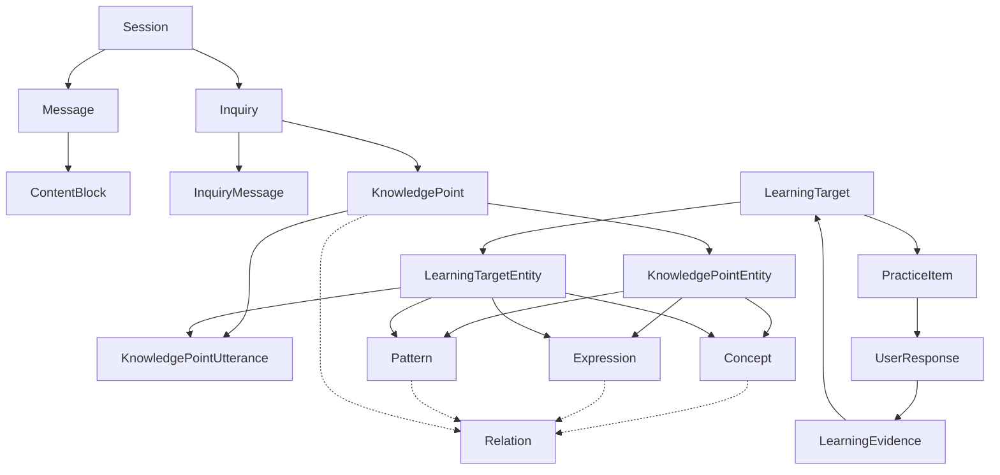
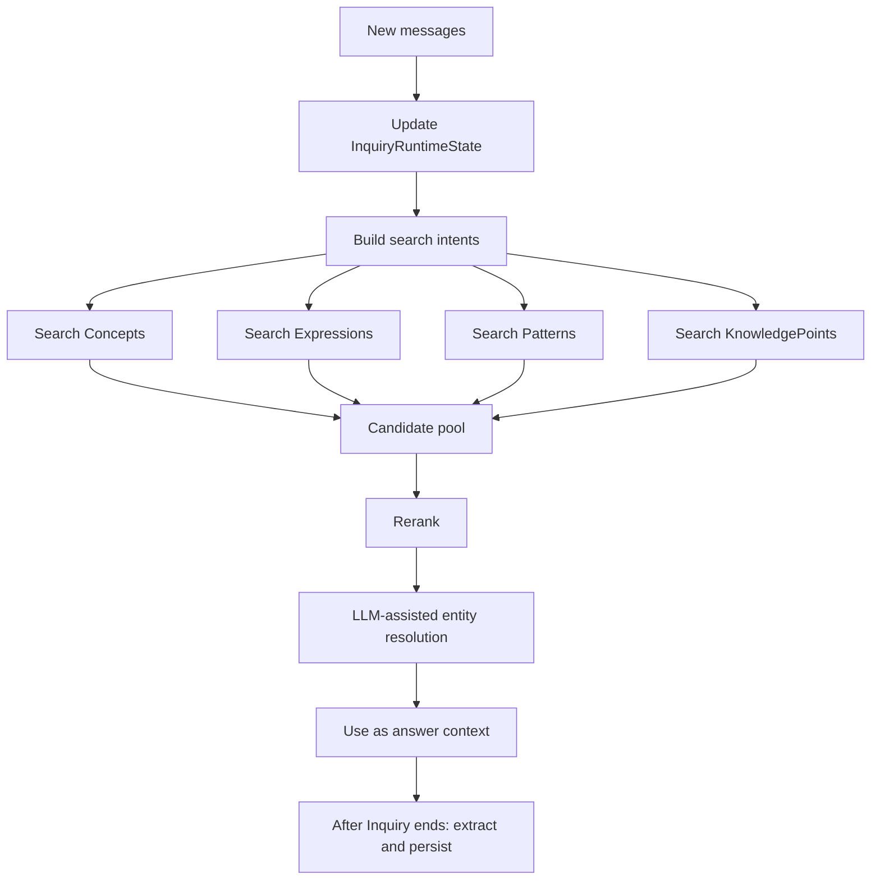

# LanguageFriction Initial Domain Model

This document defines the initial product and data model for LanguageFriction. It is the baseline for early development and should be updated deliberately when the model changes.

The app is for B2 to C1 language learners who often ask AI small daily expression questions, such as "how do I say the crescent shape on a fingernail?" or "how do I ask for extra bacon bits on a baked potato?". The core product goal is to turn these natural AI conversations into durable, reviewable, personalized language knowledge.

The model intentionally avoids becoming a full dictionary, textbook syllabus, or world knowledge graph. It preserves concrete expression friction first, then gradually extracts reusable concepts, expressions, and patterns.

## Core Principles

1. Raw conversation and learned knowledge are separate.
2. An Inquiry is extracted from a conversation after the fact; it is not the same as a single message.
3. A KnowledgePoint is the user-specific learning result of an Inquiry.
4. Concept, Expression, and Pattern are reusable knowledge entities.
5. Utterance is not a global entity in the initial model. It belongs to a KnowledgePoint as the concrete answer or example sentence.
6. Relations should be sparse, typed, and evidence-based. Do not persist vague "related" edges unless they support retrieval, review, distinction, or personalization.
7. LearningTarget represents trainable mastery state, not the knowledge entity itself.
8. UserResponse should not directly update mastery. It produces LearningEvidence, which then updates LearningTarget.

## High-Level Flow



## 1. User-Side Raw Information

### Session

A Session is one natural AI conversation. It is a raw interaction container, not a learning unit.

One Session may contain zero, one, or many Inquiries.

Suggested fields:

```ts
Session {
  id: string
  userId: string
  title?: string
  startedAt: Date
  endedAt?: Date
  lastMessageAt: Date
  status: "active" | "closed" | "archived"
}
```

`lastMessageAt` stores the latest message interaction time in the Session. It is used for opening the user's most recent conversation and sorting history by recent activity. If a Session has no Messages yet, it should default to `startedAt`.

### Message

A Message is one chat message inside a Session.

Suggested fields:

```ts
Message {
  id: string
  sessionId: string
  role: "user" | "assistant" | "system"
  sequence: number
  createdAt: Date
}
```

### ContentBlock

A ContentBlock is a structured piece of Message content.

This is needed because answers may include text, diagrams, images, audio, or structured annotations. For example, explaining "chamfer" may require a diagram instead of plain text.

Suggested fields:

```ts
ContentBlock {
  id: string
  messageId: string
  type: "text" | "image" | "audio" | "diagram" | "structured"
  content: unknown
  metadata?: Record<string, unknown>
  sequence: number
}
```

## 2. Post-Processing Entities

### Inquiry

An Inquiry is a specific expression question extracted from a Session.

It corresponds to a concrete context like:

> In a restaurant, how do I naturally ask for extra bacon bits on a baked potato?

An Inquiry is created during a summarization or extraction task. It may be created automatically, manually saved by the user, or refined later.

Suggested fields:

```ts
Inquiry {
  id: string
  sessionId: string
  title: string
  userNeed: string
  contextSummary: string
  primaryLanguageContext: string
  sourceLanguage?: string
  targetLanguage: string
  status: "draft" | "extracted" | "archived"
  createdFrom: "auto_summary" | "manual_save" | "system_suggested"
  createdAt: Date
  updatedAt: Date
}
```

`primaryLanguageContext` stores background information, source wording, or examples in the learner's primary language. For example, when a Chinese speaker asks how to express something in English, this field should preserve a Chinese explanation or example so later extraction, knowledge drafting, and practice generation can understand the original intent.

### InquiryMessage

InquiryMessage links an Inquiry back to the Messages that formed it.

This replaces the earlier idea of using Mention as a core entity. Entity extraction is based on the whole Inquiry, not on isolated message spans.

Suggested fields:

```ts
InquiryMessage {
  inquiryId: string
  messageId: string
  role:
    | "primary_question"
    | "clarification"
    | "answer"
    | "correction"
    | "supporting"
  sequence?: number
}
```

## 3. Knowledge Entities

### Concept

A Concept is a stable meaning or real-world idea. It is what something is, not how it is said.

Examples:

- bacon bits
- baked potato
- power outlet
- plug
- chamfer
- fillet

Suggested fields:

```ts
Concept {
  id: string
  canonicalLabel: string
  languageHint?: string
  definition?: string
  domain?: string[]
  aliases?: string[]
  disambiguationNote?: string
  status: "active" | "merged" | "archived"
  createdAt: Date
  updatedAt: Date
}
```

Notes:

- A Concept may have labels in Chinese, English, or another language.
- A Concept is not a vocabulary item by itself.
- Concepts should only be created when they are primary, user-mentioned, useful for future retrieval, or needed for distinction.
- If the assistant merely uses a related concept in an explanation, that concept can remain transient unless it already exists or is learning-relevant.

### Expression

An Expression is how a Concept is expressed in a specific language and usage context. It usually corresponds to a word, phrase, collocation, or short expression, but it is not a context-free dictionary entry.

For example, the Concept "power outlet" may be expressed as `power outlet` in a US everyday setting, `socket` in another regional or technical context, or a longer request phrase inside a KnowledgePoint.

Examples:

- `bacon bits`
- `baked potato`
- `power outlet`
- `socket`
- `on the side`
- `Can I get extra ...?`

Suggested fields:

```ts
Expression {
  id: string
  text: string
  language: string
  normalizedText: string
  partOfSpeech?: string
  register?: string
  region?: string
  domain?: string[]
  meaningNote?: string
  usageNote?: string
  status: "active" | "merged" | "archived"
  createdAt: Date
  updatedAt: Date
}
```

Field notes:

- `normalizedText` is the canonical lookup form used for matching and deduplication. It may lowercase, trim, normalize punctuation, or otherwise apply language-specific normalization while preserving `text` as the display form.
- `partOfSpeech` is optional linguistic metadata for word-level expressions. It should remain empty for phrase, sentence, or pattern-like expressions where a single part of speech would be misleading.
- `domain` is a lightweight set of usage domains such as `food`, `restaurant`, `engineering`, or `daily_life`. It is for retrieval and filtering, not a formal ontology.
- `meaningNote` explains what this expression means in this usage context, especially when the same text is ambiguous.
- `usageNote` explains how, when, or by whom this expression is naturally used, including register, region, collocation, or pragmatic constraints.

Expression to Concept mapping is represented by `Relation`, not a dedicated join table, because expression-to-concept links need the same evidence, confidence, status, and graph behavior as other knowledge relations.

### Pattern

A Pattern is a reusable language structure discovered through offline analysis or careful system suggestion.

It should not be created eagerly for every utterance. It is valuable only when it has transfer value.

Examples:

- `Could I get extra {TOPPING} on {FOOD}?`
- `Can I get {THING} on the side?`
- `X is more of a {CATEGORY_A} than a {CATEGORY_B}.`

Suggested fields:

```ts
Pattern {
  id: string
  template: string
  language: string
  slots: Array<{
    name: string
    constraint?: string
    examples?: string[]
  }>
  explanation?: string
  usageScope?: string
  confidence: number
  source: "offline_induction" | "manual" | "system_suggested"
  status: "candidate" | "active" | "rejected" | "archived"
  createdAt: Date
  updatedAt: Date
}
```

Pattern discovery should usually come from repeated Utterances, repeated Expressions, or repeated user friction. A single sentence can suggest a candidate pattern, but it should usually remain unpromoted.

### KnowledgePoint

A KnowledgePoint is the user-specific learning unit created from an Inquiry.

It represents the answer to "what did the user actually learn from this Inquiry?".

Examples:

- How to naturally ask for extra bacon bits on a baked potato in a restaurant.
- How to distinguish `chamfer` from `fillet`.
- How to say "power outlet" instead of translating too literally.

Suggested fields:

```ts
KnowledgePoint {
  id: string
  inquiryId: string
  title: string
  objective: string
  contextSnapshot: Record<string, unknown>
  explanation?: string
  status: "active" | "archived"
  createdAt: Date
  updatedAt: Date
}
```

### KnowledgePointUtterance

An Utterance is a complete sentence or complete wording used in a specific context.

In the initial model, Utterance is not a global reusable entity. It is stored under KnowledgePoint.

During Inquiry-to-Knowledge extraction, Utterances should be target-language results only. Source-language or learner-primary-language explanations belong in Inquiry context, KnowledgePoint explanation, Concept labels, or notes instead. `incorrect` and `literal_translation` utterances should still be attempted target-language wordings.

This still allows LearningTarget to train an Utterance by referencing this record.

Suggested fields:

```ts
KnowledgePointUtterance {
  id: string
  knowledgePointId: string
  text: string
  language: string
  role:
    | "recommended"
    | "alternative"
    | "contrast"
    | "incorrect"
    | "literal_translation"
  usageNote?: string
  createdAt: Date
}
```

### KnowledgePointEntity

KnowledgePointEntity links a KnowledgePoint to the reusable entities it contains or depends on.

Suggested fields:

```ts
KnowledgePointEntity {
  knowledgePointId: string
  entityType: "concept" | "expression" | "pattern"
  entityId: string
  role: "primary" | "supporting" | "contrast" | "context" | "derived"
}
```

## 4. Relations

Relation connects knowledge entities.

Relations are not ownership. For example, Concept to Expression mapping is a knowledge relation, while KnowledgePoint to Utterance is content ownership.

Suggested fields:

```ts
Relation {
  id: string
  fromType: "concept" | "expression" | "pattern" | "knowledge_point"
  fromId: string
  toType: "concept" | "expression" | "pattern" | "knowledge_point"
  toId: string
  type: RelationType
  direction: "directed" | "undirected"
  confidence: number
  source: "user" | "system" | "inquiry" | "offline"
  status: "suggested" | "confirmed" | "rejected"
  evidence?: Record<string, unknown>
  createdAt: Date
  updatedAt: Date
}

type RelationType =
  | "expresses"
  | "partially_expresses"
  | "ambiguous_with"
  | "used_with"
  | "part_of"
  | "is_a"
  | "contrast_with"
  | "confusable_with"
  | "variant_of"
  | "instantiates"
  | "derived_from"
  | "follow_up"
  | "refines"
  | "similar_learning_case"
  | "related_in_context"
```

Initial relation guidance:

- Concept to Concept: use `used_with`, `part_of`, `is_a`, `contrast_with`, `confusable_with`.
- Expression to Concept: use `expresses`, `partially_expresses`, or `ambiguous_with`.
- Expression to Expression: use `variant_of`, `contrast_with`, `confusable_with`.
- Pattern to Expression or KnowledgePoint: use `instantiates` or `derived_from` when needed.
- KnowledgePoint to KnowledgePoint: use only for personal learning relations such as `follow_up`, `refines`, or `similar_learning_case`.
- Do not create global Concept relations just because the assistant mentioned a supporting concept. Prefer user-triggered or review-useful relations.

### Knowledge Deletion Semantics

Deleting a KnowledgePoint removes that user-specific learning result, its local Utterances, its LearningTargets, and PracticeItems that become unanchored after those targets are removed.

Concept, Expression, and Pattern records linked to the deleted KnowledgePoint should be deleted only when they no longer have any KnowledgePointEntity or LearningTargetEntity anchors. Entities still used by another KnowledgePoint or LearningTarget are treated as independent reusable entities and must be retained.

Deleting a Knowledge Entity from the entity browser removes its KnowledgePointEntity links and Relations. LearningTargets that no longer have any LearningTargetEntity anchors after that removal should also be deleted, along with PracticeItems that become unanchored.

## 5. Learning Entities

### LearningTarget

LearningTarget is the user's trainable mastery state for one or more pieces of knowledge.

It is not identical to Concept, Expression, Pattern, or Utterance. A single Expression can have multiple LearningTargets, and one LearningTarget can combine multiple entities.

Examples:

- Recall the expression `bacon bits`.
- Produce the full restaurant request: "Could I get extra bacon bits on my baked potato?"
- Distinguish `chamfer` from `fillet`.
- Transfer the pattern `Could I get extra {TOPPING} on {FOOD}?`.

Suggested fields:

```ts
LearningTarget {
  id: string
  userId: string
  knowledgePointId?: string
  ability:
    | "recognition"
    | "recall"
    | "contextual_production"
    | "transfer"
    | "distinction"
  status: "active" | "paused" | "mastered" | "archived"
  priority: number

  difficulty?: "low" | "medium" | "high"
  stability?: number
  dueAt?: Date
  lastReviewedAt?: Date
  reviewCount: number
  lapseCount: number

  schedulingAlgorithm?: string
  schedulingVersion?: string
  createdAt: Date
  updatedAt: Date
}
```

Scheduling fields live on LearningTarget because they are user-specific and target-specific.

`difficulty` is a coarse human-readable bucket for initial scheduling and UI grouping. It is intentionally not a numeric model score at this stage.

`stability` is the estimated durability of the user's memory for this target, usually interpreted by a spaced repetition algorithm as how long the target is likely to remain recallable. It is optional until a scheduling algorithm is chosen and enough LearningEvidence exists.

### LearningTargetEntity

LearningTargetEntity links a LearningTarget to the specific content being trained.

Suggested fields:

```ts
LearningTargetEntity {
  learningTargetId: string
  entityType: "concept" | "expression" | "pattern" | "utterance"
  entityId: string
  role: "primary" | "prompt" | "required" | "contrast" | "supporting"
}
```

Notes:

- For `entityType: "utterance"`, `entityId` references `KnowledgePointUtterance.id`.
- Concept is often a prompt or support entity rather than the primary target.
- Expression is often the primary target for recall.
- Utterance is often the primary target for contextual production.
- Pattern is usually a target only after it has shown transfer value.

### PracticeItem

PracticeItem is one concrete generated exercise.

It is an instance of practice, not the long-term mastery state.

PracticeItem content is materialized when the LearningTarget is turned into a review item. The materialization flow is:

```text
MaterializeTarget -> LLM practice content generation -> PracticeItem.prompt, expectedAnswer, acceptableAnswers
```

`type` is retained for compatibility and future display variants, but generated practice items currently use `free_response` uniformly. The practice intent is derived from the LearningTarget ability and materialization context; it should not be regenerated as learner-facing prompt metadata.

Suggested fields:

```ts
PracticeItem {
  id: string
  type:
    | "flashcard"
    | "free_response"
    | "translation"
    | "scenario_response"
    | "multiple_choice"
    | "correction"
  prompt: unknown
  expectedAnswer?: unknown
  acceptableAnswers?: unknown
  contextSnapshot?: Record<string, unknown>
  generatedAt: Date
  expiresAt?: Date
}
```

`prompt` stores the complete learner-facing display payload for the exercise, not only a text question or a pointer to source context. The current generated shape should stay simple, with a short title and one Markdown prompt body that includes every visible instruction, scenario, constraint, and hint needed to render the item later.

`expectedAnswer` and `acceptableAnswers` are generated and persisted at the same time as `prompt`. They should reflect the specific materialized exercise, not be regenerated at answer time.

`contextSnapshot` stores the practice-time scenario and constraints needed to evaluate the answer, such as domain, speaker/listener roles, target language, region, register, source KnowledgePoint context, or any generated prompt variables. It should be a snapshot, not a live pointer to mutable context.

### PracticeItemTarget

A PracticeItem can train one or more LearningTargets.

Suggested fields:

```ts
PracticeItemTarget {
  practiceItemId: string
  learningTargetId: string
  weight: number
}
```

### UserResponse

UserResponse is the user's answer to a PracticeItem.

Suggested fields:

```ts
UserResponse {
  id: string
  practiceItemId: string
  userId: string
  answer: unknown
  submittedAt: Date
  feedback?: unknown
}
```

### LearningEvidence

LearningEvidence is the evaluated effect of a UserResponse on a specific LearningTarget.

This layer is necessary because one response can affect multiple targets, and one practice item may test some targets directly while only exposing others.

Suggested fields:

```ts
LearningEvidence {
  id: string
  userResponseId: string
  learningTargetId: string
  result: "correct" | "partial" | "failed" | "hinted" | "exposed" | "not_tested"
  confidence?: number
  error?: unknown
  createdAt: Date
}
```

LearningEvidence updates LearningTarget scheduling state. UserResponse should not update LearningTarget directly.

`result` is the source of truth for success or failure. There is no separate numeric score until the product has a reliable quantification method.

`error` stores structured evaluation details when available, such as missing expression, wrong register, unnatural collocation, or confused contrast target. User-facing feedback belongs on `UserResponse.feedback`, so it is not duplicated here.

## 6. Local App Settings

Local app settings store non-secure product preferences. They are not part of the language knowledge graph or learning domain state.

Suggested fields:

```ts
AppSetting {
  key: string
  valueJson: unknown
  updatedAt: Date
}
```

Initial setting keys:

- `practiceReminder`: controls whether the app polls local due LearningTargets and shows a top reminder. This should not be stored in SecureStore because it is not secret data.
- `languagePreferences`: stores the learner's primary language and learning language. Initial supported language codes are `en`, `zh`, `de`, `ja`, and `fr`. This should not be stored in SecureStore because it is not secret data.

## 7. Runtime Search and Entity Resolution

During a conversation, the app may search existing knowledge to personalize the answer. However, it should avoid writing formal knowledge entities while the user is still clarifying the question.

Recommended runtime flow:



Search should be hybrid:

- lexical search for exact text, aliases, and normalized forms
- embedding search for semantic similarity
- alias lookup for known equivalent names
- graph neighborhood lookup for existing adjacent knowledge
- personal recency and review history as small ranking signals

Search results should return candidates by entity type:

```ts
SearchResult {
  concepts: ConceptCandidate[]
  expressions: ExpressionCandidate[]
  patterns: PatternCandidate[]
  knowledgePoints: KnowledgePointCandidate[]
}
```

Entity resolution decides whether to link, create, create a variant, or ignore:

```ts
EntityResolutionDecision {
  entityType: "concept" | "expression" | "pattern" | "knowledge_point"
  candidateId?: string
  decision: "link" | "create_new" | "create_variant" | "ignore"
  confidence: number
  reason: string
  evidence: string[]
}
```

The LLM should not be the only source of thresholds. Retrieval scores should be computed first, then the LLM performs semantic judgment over a small candidate set.

## 8. Example: Extra Bacon Bits on a Baked Potato

User input:

> 吃饭的时候我想要额外的烤土豆上的培根碎怎么表达

Possible answer:

> Could I get extra bacon bits on my baked potato?

Possible Inquiry:

```ts
Inquiry {
  title: "Ask for extra bacon bits on a baked potato"
  userNeed: "在餐厅自然地请求给烤土豆额外加培根碎"
  contextSummary: "User is ordering food in a restaurant, likely asking a server."
  primaryLanguageContext: "用户想在餐厅点烤土豆时，请服务员额外加培根碎。"
  sourceLanguage: "zh-CN"
  targetLanguage: "en"
}
```

Possible Concepts:

```ts
Concept {
  canonicalLabel: "培根碎"
  aliases: ["bacon bits", "crumbled bacon"]
  domain: ["food", "topping"]
}

Concept {
  canonicalLabel: "烤土豆"
  aliases: ["baked potato"]
  domain: ["food"]
}
```

Possible Expressions:

```ts
Expression {
  text: "bacon bits"
  language: "en"
  normalizedText: "bacon bits"
  domain: ["food"]
}

Expression {
  text: "baked potato"
  language: "en"
  normalizedText: "baked potato"
  domain: ["food"]
}
```

Possible KnowledgePoint:

```ts
KnowledgePoint {
  title: "Ask for extra bacon bits on a baked potato"
  objective: "在餐厅自然地请求给烤土豆多加培根碎"
  contextSnapshot: {
    domain: "restaurant",
    speakerRole: "customer",
    listenerRole: "server",
    region: "US",
    register: "polite-casual"
  }
}
```

Possible KnowledgePointUtterance:

```ts
KnowledgePointUtterance {
  text: "Could I get extra bacon bits on my baked potato?"
  language: "en"
  role: "recommended"
  usageNote: "Natural polite-casual restaurant phrasing."
}
```

Possible LearningTargets:

```ts
LearningTarget {
  ability: "recall"
  status: "active"
}

LearningTargetEntity {
  entityType: "expression"
  entityId: "<bacon bits expression id>"
  role: "primary"
}
```

```ts
LearningTarget {
  ability: "contextual_production"
  status: "active"
}

LearningTargetEntity {
  entityType: "utterance"
  entityId: "<recommended utterance id>"
  role: "primary"
}
```

Optional future Pattern:

```ts
Pattern {
  template: "Could I get extra {TOPPING} on {FOOD}?"
  language: "en"
  slots: [
    { name: "TOPPING", constraint: "food topping or ingredient" },
    { name: "FOOD", constraint: "prepared food item" }
  ]
  source: "offline_induction"
  status: "candidate"
}
```

This Pattern should usually be promoted only after the system sees enough similar cases, such as asking for extra pickles on a burger or extra cheese on fries.

## 9. Open Design Decisions

These are intentionally not fixed yet:

1. Whether `KnowledgePointUtterance` should eventually be promoted into a global `Utterance` entity.
2. How aggressive Pattern induction should be.
3. Which spaced repetition algorithm to use for LearningTarget scheduling.
4. Whether Topics or Scenarios should become independent entities. Initial decision: no; keep them inside `contextSnapshot` or lightweight tags until reuse is proven.
5. How much manual user control should exist for confirming, rejecting, or merging system-suggested relations.

## Initial Entity List

Raw layer:

- Session
- Message
- ContentBlock

Post-processing layer:

- Inquiry
- InquiryMessage

Knowledge layer:

- Concept
- Expression
- Pattern
- KnowledgePoint
- KnowledgePointUtterance
- KnowledgePointEntity
- Relation

Learning layer:

- LearningTarget
- LearningTargetEntity
- PracticeItem
- PracticeItemTarget
- UserResponse
- LearningEvidence

Local settings layer:

- AppSetting
